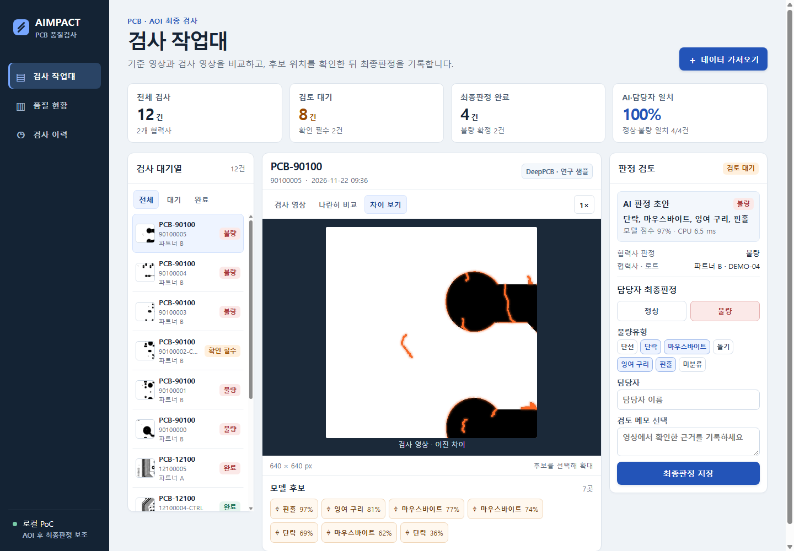

# AIMPACT PCB 품질검사 MVP

**협력사 검사 데이터를 가져오고, AI 후보를 검토해 최종판정을 기록하는 PCB AOI 작업대입니다.**



## 빠른 시작

이 저장소를 내려받거나 [릴리스 ZIP](https://github.com/lje9530/aimpact-pcb-mvp/releases/latest)을 푼 뒤 폴더에서 실행하세요. Python 3.11–3.13이 필요합니다.

```powershell
python -m venv .venv
.\.venv\Scripts\python.exe -m pip install .
.\.venv\Scripts\python.exe run.py
```

macOS·Linux에서는 `.\.venv\Scripts\python.exe` 대신 `.venv/bin/python`을 사용합니다. 브라우저에서 **http://127.0.0.1:8765**를 열면 DeepPCB 예제 12건이 바로 로드됩니다. 앱은 CPU로 동작하고 기록은 로컬 SQLite에 저장합니다.

## 90초 시연

1. **검사 작업대**에서 기준 영상과 검사 영상을 나란히 보고, 주황색 차이와 모델 후보를 클릭해 확대합니다.
2. **판정 검토**에서 유형이나 정상·불량 판정을 수정하고 저장합니다. AI 초안과 담당자 판정 차수가 기록에 남습니다.
3. **품질 현황**에서 반복 불량과 AI·담당자 일치 건수를 확인합니다. **검사 이력**에서 제품·기간·유형으로 조회하고 엑셀로 내려받습니다.

업로드를 시연하려면 **데이터 가져오기 → 업로드 예제 ZIP**을 사용하세요. CSV 또는 XLSX의 열을 제품코드·검사일시·검사 영상 파일명에 연결하고, 협력사별 매핑을 저장해 다음 업로드에서 재사용할 수 있습니다.

## 모델 학습·평가 재현

DeepPCB 검사 영상과 기준 영상에서 차이 후보를 추출해 **랜덤 포레스트와 로지스틱 회귀를 직접 학습**했습니다. [학습 1,000쌍](data/splits/train.csv), [검증 112쌍](data/splits/validation.csv), [테스트 220쌍](data/splits/test.csv)은 서로 다른 보드 그룹으로 나눴습니다. 분할 생성·학습·최종 평가는 각 단계로 실행할 수 있습니다. [원본 ZIP부터 재현하는 방법](docs/PCB_REPRODUCTION.md)

## 시연 데이터와 모델

동봉한 DeepPCB 사례와 모델은 연구용입니다. 모델은 동일 해상도로 정렬된 기준 영상과 검사 영상의 차이에서 후보를 찾습니다. 기준 영상이 빠진 건은 담당자 확인으로 넘깁니다. 테스트 불량 영상은 220장 중 204장(92.7%)을 후보로 잡았고, 유형과 위치를 함께 맞히는 F1은 0.432였습니다. 정상 대조군은 기준 영상 자기 비교로 구성했습니다. 화면에 미리 들어간 판정 4건은 시연용 기록입니다.

[실행·운영 매뉴얼](docs/PCB_MVP.md) · [벤치마크와 재현 절차](docs/PCB_BENCHMARK.md) · [데이터 출처](data/pcb_demo/SOURCE.md)
